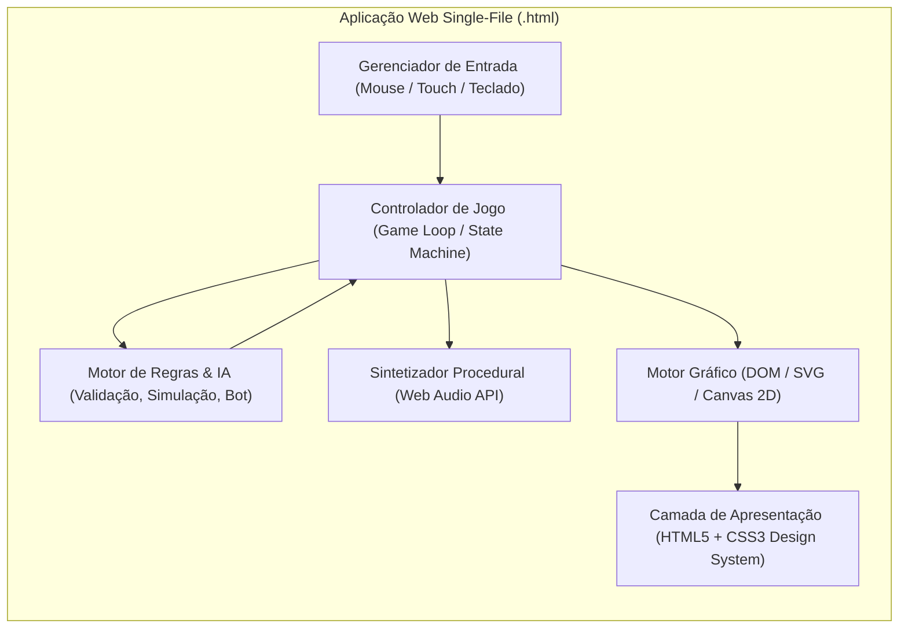

# Arquitetura do Projeto — Suíte de Jogos Educativos & Infantis (`Pedro`)

Este documento descreve a arquitetura, os padrões de projeto, a pilha tecnológica e o funcionamento interno dos jogos interativos contidos neste repositório. Ele serve como referência técnica e guia de contexto para evolução e manutenção do projeto.

---

## 1. Visão Geral do Projeto

O projeto consiste em uma coleção de jogos web interativos, educativos e visualmente ricos, projetados especificamente para **crianças (foco na faixa etária de 7 anos)** jogarem no navegador (Desktop, Tablet ou Celular).

### Estrutura do Diretório
```text
c:\Users\patri\Documents\Pedro\
├── avião.html     # Simulador de Cabine: Comissário de Bordo (AeroVoo 702)
├── uno.html       # UNO Mania Kids: Jogo de Cartas 1v1 contra Robô
├── xadrez.html    # Xadrez Clássico & Minimalista com IA Multinível e Modo Didático
└── GEMINI.md      # Documento de Arquitetura e Diretrizes do Projeto
```

---

## 2. Princípios Arquiteturais Fundamentais

Todos os módulos do projeto seguem quatro pilares arquiteturais estritos:

1. **Arquitetura Single-File (Autocontida):**
   - Cada jogo reside em um único arquivo `.html` que encapsula **Design System (CSS3)**, **Marcação Semântica (HTML5)**, **Ativos Gráficos Vetoriais/Canvas** e **Motor Lógico (JavaScript ES6+)**.
   - Basta um duplo clique no arquivo para executá-lo instantaneamente em qualquer navegador moderno via protocolo `file://`, sem necessidade de servidores locais, *bundlers* ou instalação de pacotes.

2. **Zero Dependências Externas (100% Offline-First):**
   - Nenhum arquivo depende de CDNs, fontes externas, imagens externas ou arquivos `.mp3`/`.wav`.
   - **Gráficos:** Desenhados via **SVG inline vetorial**, **CSS3 3D/Gradientes** ou renderizados proceduralmente via **HTML5 Canvas 2D**.
   - **Áudio:** Todos os efeitos sonoros e ambientes acústicos são sintetizados matematicamente em tempo real usando a **Web Audio API** nativa do navegador (osciladores senoidais, triangulares, dente-de-serra, filtros passa-baixa e buffers de ruído).

3. **UX Pedagógica e Centrada na Criança (7 Anos):**
   - **Ritmo Calmo e Acolhedor:** Intervalos de pensamento da IA (ex.: `1500ms` no UNO, `450ms–900ms` no Xadrez) e barras de tempo lentas no Simulador de Voo (`24s–35s`) permitem que a criança acompanhe cada ação sem estresse.
   - **Feedback Visual e Sonoro Imediato:** Alertas amigáveis (*Toasts*), animações de sacudida (*shake*) em jogadas inválidas e telas comemorativas com confetes.

4. **Acessibilidade Tríplice (Mouse, Toque e Teclado):**
   - Suporte simultâneo e sem conflitos para clique de mouse, toque em telas *mobile/tablet* e atalhos completos de teclado.

---

## 3. Visão Geral da Arquitetura Comum



---

## 4. Detalhamento Técnico por Módulo

### 4.1. Simulador de Cabine — `avião.html`
**Título:** *Comissário de Bordo: Simulador de Cabine (AeroVoo 702)*

Jogo de ação calma em rolagem lateral (*side-scrolling*) onde a criança controla um comissário de bordo atendendo passageiros da Primeira Classe (VIP), Classe Econômica e os Pilotos no Cockpit durante um voo de 3 minutos entre São Paulo (GRU) e Paris (CDG).

#### Arquitetura Interna e Classes
- **`FlightSoundEngine`:**
  - Gera som contínuo de turbina de avião usando um `AudioBuffer` de ruído branco filtrado por um `BiquadFilterNode` (*lowpass* em 140Hz) somado a um oscilador senoidal de baixa frequência (85Hz).
  - Sintetiza o sinal sonoro clássico de cabine (*ding-dong* em 698.46Hz e 523.25Hz), som de rádio dos pilotos, entrega de itens e acordes de sucesso/erro.
- **`TRAY_ITEMS` (Registro Estático):**
  - Mapeia os 5 itens da bandeja pronta para entrega imediata via clique ou atalho de teclado:
    - `[B]` Balinha (🍬), `[C]` Café (☕), `[L]` Lanche (🥪), `[S]` Snack (🥨), `[R]` Bebida (🥤).
- **`NinjaFlightSimulator` (Motor Canvas 2D & Game Loop):**
  - **Mundo Virtual:** Dimensões de `2600x720` pixels com câmera suave interpolada (`cameraX`) acompanhando o jogador.
  - **Zonas da Aeronave:**
    1. *Cockpit (`x < 440`):* Para-brisa com nuvens dinâmicas, telas PFD (horizonte artificial) e Radar ND animados, LEDs piscantes e dois pilotos que dão "joia" (👍) ou pedem café/lanche ocasionalmente (`+5 pts`).
    2. *Primeira Classe VIP (`x: 470–1010`):* 3 poltronas executivas douradas (`1A`, `2A`, `3A`). Entregas corretas valem **`+10 pontos`**.
    3. *Classe Econômica (`x: 1060–1940`):* 5 poltronas azuis (`10A` a `14A`). Entregas corretas valem **`+5 pontos`**; erros ou tempo esgotado descontam **`-1 ponto`** (o placar aceita valores negativos).
    4. *Galley / Cozinha de Bordo (`x: 2000–2600`):* Trolleys e cafeteira com animação de vapor.
  - **Controle de Fluxo Calmo (`spawnOrder`):** Limita os pedidos a no máximo **2 passageiros simultâneos**, com barras de paciência longas (`24s` a `35s`) e radar de setas nas bordas da tela (`renderOffScreenAlertArrows`) para indicar chamados fora do campo de visão.

---

### 4.2. Jogo de Cartas — `uno.html`
**Título:** *UNO Mania Kids*

Partida de UNO no formato 1 contra 1 (Jogador Humano vs. Robô Amigo), com visual de mesa de feltro escuro, cartas vetoriais construídas em CSS e mecânicas especiais.

#### Arquitetura Interna e Classes
- **`UnoAudio`:**
  - Sintetizador Web Audio API com persistência de *mute* no `localStorage` (`uno_muted`).
  - Efeitos dedicados: deslize de carta (`playCardPlay`), compra (`playDraw`), bloqueio/ação (`playActionZap`), explosão do Baralho Todo (`playAllDeck`), troca mágica de mãos (`playSwap`), grito de UNO (`playUnoShout`), penalidade (`playPenalty`) e fanfarra de vitória (`playVictory`).
- **`ConfettiEffect`:**
  - Sistema de partículas em HTML5 Canvas (`#confettiCanvas`) sobreposto à tela para celebrar vitórias.
- **`UnoDeckManager`:**
  - Gera e embaralha (algoritmo *Fisher-Yates*) um baralho de **113 cartas**:
    - Cartas numéricas de `0` a `9` nas 4 cores (`red`, `blue`, `green`, `yellow`).
    - Cartas de ação por cor: Bloqueio (`skip` 🚫), Inverter (`reverse` ⇄ — atua como bloqueio no 1v1) e Comprar +2 (`draw2` +2).
    - Cartas Coringa especiais:
      1. **Coringa Escolha de Cor (`wild` 🎨):** 4 unidades.
      2. **Coringa Comprar +4 (`wild4` +4):** 4 unidades.
      3. **Coringa Baralho Todo (`wildAll` TUDO):** 2 unidades (Ultra Carta com borda cósmica pulsante que força o oponente a comprar 25 cartas de uma vez com animação de cartas voando).
      4. **Coringa Trocar de Mão (`swapHands` 🔄):** 3 unidades (troca imediatamente os arrays de cartas entre o jogador e o robô).
- **`UnoGame` (Controlador de Estado e Turnos):**
  - **Reciclagem Infinita (`ensureDrawPileHasCards`):** Reembaralha a pilha de descarte automaticamente quando o monte baixa do limite mínimo e gera novos lotes caso compras massivas (como o *Baralho Todo*) esgotem as cartas disponíveis, garantindo que o jogo nunca trave.
  - **Interface Natural na Vez do Jogador:** As cartas da mão do jogador mantêm aparência uniforme e normal, sem destacar ou entregar quais cartas são jogáveis. A criança observa a cor/símbolo da mesa para decidir; se clicar em uma carta incompatível, a carta executa uma animação de sacudida (`shake`) e exibe uma dica educativa.
  - **Mecânica de Gritar "UNO!":** Ao jogar a penúltima carta (restando 1 carta na mão), inicia-se uma janela regressiva de **4 segundos** (`startUnoTimerWindow`) com alerta luminoso no botão `UNO!`. Se o jogador não clicar a tempo, recebe automaticamente `+2 cartas` de penalidade (`handleUnoPenalty`).
  - **IA do Robô (`executeRobotTurn`):** Aguarda `1500ms` para simular pensamento humano, prioriza cartas numéricas em 65% das ocasiões para guardar coringas, escolhe a cor predominante de sua mão ao lançar coringas (`getRobotsBestColor`) e anuncia `"UNO! 🤖⚡"` em um balão de fala quando fica com 1 carta.

---

### 4.3. Xadrez Didático — `xadrez.html`
**Título:** *Xadrez Clássico & Minimalista*

Aplicação completa de Xadrez com regras oficiais da FIDE, peças vetoriais Staunton de alto contraste, painel lateral otimizado para maximizar o tamanho do tabuleiro (`até 750px / 84vh`) e um sistema de tutoria em tempo real.

#### Arquitetura Interna e Classes
- **`PIECE_SVGS`:**
  - Biblioteca de 12 peças vetoriais SVG (`wp`, `wn`, `wb`, `wr`, `wq`, `wk`, `bp`, `bn`, `bb`, `br`, `bq`, `bk`) desenhadas com contornos duplos e alto contraste para perfeita leitura tanto no tabuleiro quanto nos contadores de peças capturadas (`34x34px` com halo claro para peças pretas).
- **`SynthesizedAudio`:**
  - Efeitos acústicos amadeirados para movimento, captura, seleção, xeque, vitória e empate, com estado salvo em `localStorage` (`chess_sound_muted`).
- **`ChessEngine` (Motor Completo de Regras):**
  - Matriz 8x8 (`this.board`), controle de turno, direitos de roque (`hasMoved`), alvo de *En Passant* (`enPassantTarget`), histórico de lances e listas de peças capturadas.
  - Geração de lances pseudo-legais (`getPseudoLegalMoves`) filtrados por simulação de integridade do Rei (`getLegalMoves` via clonagem rápida de estado `clone()`).
  - Suporte integral a **Roque Menor e Maior**, **Captura En Passant**, **Promoção de Peão**, detecção de **Xeque-mate**, **Afogamento (*Stalemate*)** e **Empate por Material Insuficiente**.
- **`ChessAI` (Motor de Inteligência Artificial em 5 Níveis):**
  - Persistência de nível em `localStorage` (`chess_difficulty`).
  - **1. `super_child` (🌟 Super Elementar) & 2. `child` (🎈 Criança 7 anos):** IA acolhedora que evita aplicar xeque-mate abrupto se houver alternativa, raramente captura a Dama ou Torre da criança e frequentemente realiza "lances presente" (*gift moves*) para a criança capturar e se divertir.
  - **3. `easy` (🌱 Fácil):** 60% de movimentos aleatórios misturados com capturas simples.
  - **4. `medium` (⚖️ Médio):** Avaliação heurística de material, controle de centro, desenvolvimento de peças menores e proteção contra ataques de peões, com 35% de chance de imprecisão humana.
  - **5. `hard` (🏆 Desafiador):** Avaliação tática profunda de trocas, defesa de peças, roque prioritário, xeque-mate imediato e domínio central.
- **`ChessGameController` & Sistema de Tutoria (`super_child`):**
  - **Avaliação Didática da Jogada Humana (`scoreWhiteMove` & `isMoveDangerousForWhite`):**
    - Quando a criança seleciona uma peça no nível **Super Elementar**, o controlador simula todos os destinos possíveis daquela peça e compara com o melhor lance global do tabuleiro (`getOverallBestWhiteMove`):
      - 🟢 **Bolinha/Anel Verde Brilhante (`.recommended`):** Indica o movimento mais recomendado para a peça selecionada.
      - 🟣 **Bolinha/Anel Roxo (`.danger`):** Alerta que mover para aquela casa deixará a peça desprotegida ou em troca desfavorável (peça em risco).
      - 💡 **Destaque Dourado de Outra Peça (`.suggested-piece`):** Se a criança clicar em uma peça cujos movimentos são muito inferiores a outra jogada disponível no tabuleiro (diferença de score $\ge 30$), o jogo destaca outra peça com um selo dourado `💡 Dica` e informa no status qual peça seria mais vantajosa mover.

---

## 5. Padrões de Interface e Estado (`localStorage`)

| Chave `localStorage` | Módulo | Descrição |
| :--- | :--- | :--- |
| `uno_muted` | `uno.html` | Estado de silenciamento do áudio no UNO (`'true'` / `'false'`). |
| `chess_sound_muted` | `xadrez.html` | Estado de silenciamento do áudio no Xadrez (`'true'` / `'false'`). |
| `chess_difficulty` | `xadrez.html` | Nível de dificuldade selecionado (`'super_child'`, `'child'`, `'easy'`, `'medium'`, `'hard'`). |
| `pedroplay_visits_*` | `index.html` | Contadores de acesso da central (`index`) e de cada jogo (`aviao`, `uno`, `xadrez`). |

---

## 6. Diretrizes de Manutenção e Evolução

Ao modificar os jogos existentes ou criar novos jogos dentro deste projeto, siga sempre estas regras:

1. **Preservar a Portabilidade Single-File:** Nunca separe CSS ou JS em arquivos externos a menos que explicitamente solicitado.
2. **Garantir Desbloqueio da Web Audio API:** Sempre inicialize ou resuma o `AudioContext` no primeiro evento de interação do usuário (`pointerdown` ou `keydown`).
3. **Priorizar a Experiência Infantil com Estética Sóbria (GitHub Dark):** Textos em português claro, botões com áreas de toque generosas, paleta sóbria inspirada no GitHub Dark (`#0d1117`, `#161b22`, `#30363d`) e acentos/hovers nas cores da bandeira da Alemanha (`#000000`, `#dd0000`, `#ffce00`).
4. **Usar Sempre Bootstrap Icons (Sem Emojis na UI):** Carregar a webfont oficial do Bootstrap Icons via CDN (`bootstrap-icons.min.css`) e utilizar elementos `<i class="bi bi-..."></i>` que funcionam como caracteres tipográficos e mudam de cor suavemente via CSS `:hover`.
